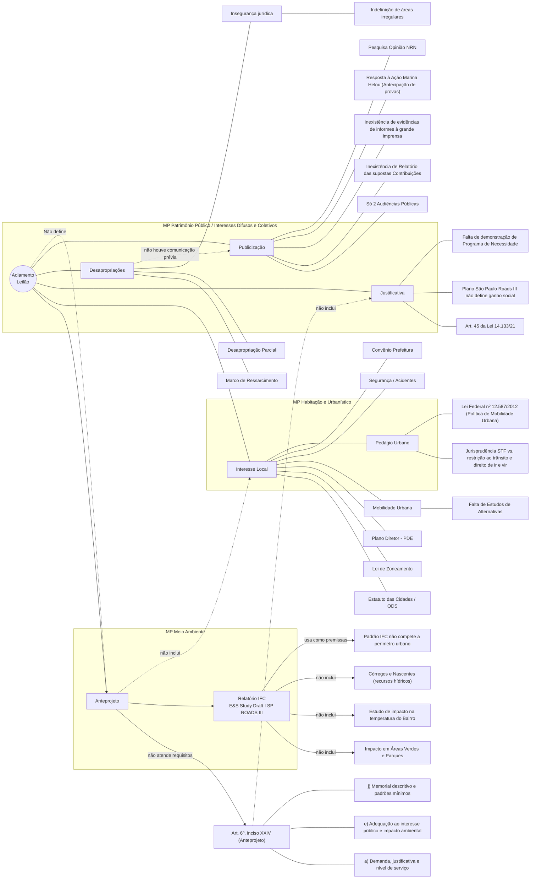

# Mapa Mental - Adiamento Leilão (SP ROADS III)

## 1. Visão Geral em Diagrama de Fluxo / Rede (Mermaid Flowchart)



---

## 2. Visão em Formato Mindmap Nativo (Mermaid Mindmap)

```mermaid
mindmap
  root((Adiamento Leilão))
    Anteprojeto
      Art. 6º inciso XXIV anteprojeto
        a) Demonstração e justificativa do programa de necessidades, avaliação de demanda
        e) Parâmetros de adequação ao interesse público, economia, facilidade, impacto ambiental e acessibilidade
        j) Memorial descritivo dos elementos da edificação, componentes construtivos e materiais
      Relatório IFC E&S Study Draft I SP ROADS III
        Não inclui Impacto em Áreas Verdes e Parques
        Não inclui Estudo de impacto na temperatura do Bairro
        Não inclui Córregos e Nascentes recursos hídrico
        Padrão de Desempenho IFC não compete a perímetro urbano
    Interesse Local
      Estatuto das Cidades ODS
      Lei de Zoneamento
      Plano Diretor - PDE
      Mobilidade Urbana
        Falta de Estudos de Alternativas
      Segurança / Acidentes
      Convênio Prefeitura
      Pedágio Urbano
        Jurisprudência STF vs. restrição ao trânsito interno e direito de ir e vir
        Lei Federal nº 12.587/2012 Política Nacional de Mobilidade Urbana
    Justificativa
      Art. 45 da Lei 14.133/21
      Plano São Paulo Roads III não define ganho social
      Falta de demonstração de Programa de Necessidade
    Desapropriações
      Marco de Ressarcimento
      Desapropriação Parcial
      Insegurança jurídica
        Indefinição de áreas irregulares
    Publicização
      Só 2 Audiências Públicas
      Inexistência de Relatório das supostas Contribuições
      Inexistência de evidências de informes à grande imprensa
      Resposta à Ação Marina Helou Antecipação de provas
      Pesquisa Opinião NRN
```
