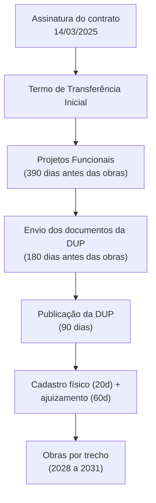
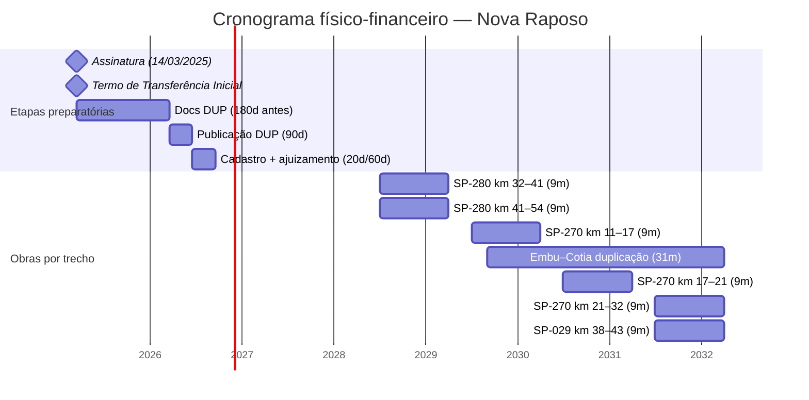

# Cronograma Físico-Financeiro — Nova Raposo

**Resumo**: Cronograma das etapas da concessão (assinatura, desapropriação e obras por trecho), a partir do Anexo 14 (Plano de Investimentos) e da planilha de análise de datas.

**Fontes**: Anexo 14 — Plano de Investimentos (análise de datas); Apresentação Desapropriações.pptx

**Última atualização**: 2026-11-10

---

## Workflow das etapas

## Cronograma temporal (Gantt)

## Investimento por ano

- **Pico** no Ano 7 (R$ 2,13 bi); ampliação principal a partir do Ano 4; duplicação nos Anos 5–7.
- Capital social mínimo de R$ 655 mi integralizado até o Ano 7.

## Versão editável (Draw.io)

Diagrama para edição: `dados/dossie/cronograma-fisico-financeiro.drawio`

## Páginas relacionadas

- [[prazos-e-obrigacoes-contratuais]]
- [[desapropriacoes-nova-raposo]]
- [[anexos-e-apendices-contrato]]
- [[contrato-concessao-nova-raposo]]
