# Contrato de Concessão — Nova Raposo

**Resumo**: Contrato nº 0548/ARTESP/2025 (Concorrência Internacional 02/2024), assinado em 14/03/2025, que delega à EcoVias Raposo-Castelo a ampliação, operação, conservação, manutenção e os investimentos da malha rodoviária do Lote Nova Raposo (SP-270, SP-280 e SP-029).

**Fontes**: `base_nrn/5.Documentos/5.3.ARTESP/5.3.3. Contrato/Nova Raposo/Lote 34 - Contrato, Anexos e Apêndices`

**Última atualização**: 2026-09-11

---

## Identificação

- **Contrato**: nº 0548/ARTESP/2025
- **Licitação**: Concorrência Internacional nº 02/2024
- **Poder Concedente**: Estado de São Paulo, por intermédio da Secretaria de Parcerias em Investimentos (SPI)
- **Concessionária**: EcoVias Raposo-Castelo
- **Intervenientes**: ARTESP e DER-SP
- **Assinatura**: 14 de março de 2025
- **Objeto**: concessão dos serviços públicos de ampliação, operação, conservação, manutenção e realização dos investimentos necessários à exploração do Sistema Rodoviário denominado Lote Nova Raposo (descrito no Anexo 02)
- **Prazo**: 30 anos, contados da assinatura do Termo de Transferência Inicial (prorrogável excepcionalmente — Cláusula 6ª)
- **Outorga fixa**: R$ 2.190.800.000,00 (R$ 2,19 bilhões)
- **Valor estimado do contrato**: R$ 7.979.783.695,82 (caráter referencial — Cláusula 7ª)
- **Processo SEI**: 134.00005927/2024-51

## Estrutura do contrato

13 capítulos e 53 cláusulas. O índice original salta o Capítulo XII (vai do XI ao XIII).

| Capítulo | Cláusulas | Conteúdo |
|---|---|---|
| I — Disposições Gerais | 1ª a 4ª | Definições; interpretação; legislação aplicável; anexos e apêndices |
| II — Da Concessão | 5ª a 15ª | Objeto; prazo e plena eficácia; valor estimado; remuneração; receita tarifária; tarifa quilométrica; receitas acessórias; regime de bens; planos de investimento; operação e eventos climáticos extremos; atualidade tecnológica |
| III — Obrigações das Partes e Equilíbrio Econômico-Financeiro | 16ª a 23ª | Direitos e obrigações da concessionária, da ARTESP/Poder Concedente e dos usuários; alocação de riscos; manutenção, eventos e recomposição do equilíbrio |
| IV — Revisões do Contrato | 24ª e 25ª | Revisão ordinária; revisões extraordinárias |
| V — Da Concessionária | 26ª a 29ª | Estrutura jurídica da SPE; transferência de controle; subcontratação; responsabilidade técnica |
| VI — Seguros e Garantias | 30ª a 34ª | Regras gerais; seguros; garantias; financiamento e garantias aos financiadores; contas da concessão |
| VII — Fiscalização | 35ª a 38ª | Pagamento pela fiscalização; fiscalização da ARTESP; atos de anuência prévia; penalidades |
| VIII — Intervenção | 39ª | Intervenção |
| IX — Extinção do Contrato | 40ª a 48ª | Hipóteses de extinção; advento do termo; indenização; encampação; caducidade; rescisão (amigável, unilateral, arbitral, relicitação); anulação; falência; caso fortuito e força maior |
| X — Reversão | 49ª a 51ª | Reversão de ativos; desmobilização; transição |
| XI — Solução de Divergências | 52ª | Solução de divergências |
| XIII — Disposições Finais | 53ª | Disposições finais |

## Anexos (01 a 23)

| Anexo | Tema |
|---|---|
| 01 | Regulamento da concessão |
| 02 | Sistema Rodoviário |
| 03 | Indicadores de Desempenho |
| 04 | Estrutura Tarifária |
| 05 | Serviços (funções operacionais) |
| 06 | Serviços de Conservação |
| 07 | Funções de ampliação |
| 08 | Acordo Tripartite |
| 09 | Termos de transferência |
| 10 | Condições de devolução |
| 11 | Penalidades |
| 12 | Projetos Funcionais da Malha Concedida |
| 13 | Cronograma de integralização do capital social |
| 14 | Plano de Investimentos |
| 15 | Transição do Sistema Rodoviário |
| 16 | Glossário |
| 17 | Condições técnicas à assinatura |
| 18 | Modelos de documentos |
| 19 | Manual de Procedimentos da B3 |
| 20 | Sistema Automático Livre (free flow) |
| 21 | EVTE (Estudo de Viabilidade Técnica e Econômica) |
| 22 | Mecanismo de Compartilhamento do Risco de Demanda |
| 23 | Solução de divergências |

## Apêndices (A a I)

| Apêndice | Tema |
|---|---|
| A.1 | Cadastro de OAE e OAC |
| A.2 | Interferências |
| B | Passivos |
| C | Fichas dos indicadores de desempenho |
| D | Contrato de Administração de contas |
| E | Acessos |
| F | Sistemas Digitais |
| G | Níveis de serviço |
| H | Procedimento para apresentação de projetos |
| I | Adequações geométricas |

## Diagrama da articulação

```mermaid
flowchart TB
    C["Contrato nº 0548/ARTESP/2025<br/>Concessão do Lote Nova Raposo<br/>14/03/2025 · 30 anos"]

    subgraph GI["CAPÍTULO I — Disposições Gerais"]
        A1["Cl. 1ª–4ª<br/>Definições · Interpretação · Legislação · Anexos e Apêndices"]
    end
    subgraph GII["CAPÍTULO II — Da Concessão"]
        A2["Cl. 5ª–15ª<br/>Objeto · Prazo · Valor · Remuneração · Tarifa quilométrica · Bens · Investimentos · Operação"]
    end
    subgraph GIII["CAPÍTULO III — Obrigações das Partes e Equilíbrio"]
        A3["Cl. 16ª–23ª<br/>Direitos/obrigações · Alocação de riscos · Equilíbrio econômico-financeiro"]
    end
    subgraph GIV["CAPÍTULO IV — Revisões"]
        A4["Cl. 24ª–25ª<br/>Revisão ordinária · extraordinárias"]
    end
    subgraph GV["CAPÍTULO V — Da Concessionária"]
        A5["Cl. 26ª–29ª<br/>SPE · Transferência de controle · Subcontratação"]
    end
    subgraph GVI["CAPÍTULO VI — Seguros e Garantias"]
        A6["Cl. 30ª–34ª<br/>Seguros · Garantias · Financiamento · Contas"]
    end
    subgraph GVII["CAPÍTULO VII — Fiscalização"]
        A7["Cl. 35ª–38ª<br/>Fiscalização ARTESP · Anuências · Penalidades"]
    end
    subgraph GVIII["CAPÍTULO VIII — Intervenção"]
        A8["Cl. 39ª<br/>Intervenção"]
    end
    subgraph GIX["CAPÍTULO IX — Extinção"]
        A9["Cl. 40ª–48ª<br/>Extinção · Encampação · Caducidade · Rescisão · Força maior"]
    end
    subgraph GX["CAPÍTULO X — Reversão"]
        A10["Cl. 49ª–51ª<br/>Reversão de ativos · Desmobilização · Transição"]
    end
    subgraph GXI["CAPÍTULO XI — Solução de Divergências"]
        A11["Cl. 52ª<br/>Solução de divergências"]
    end
    subgraph GXIII["CAPÍTULO XIII — Disposições Finais"]
        A12["Cl. 53ª<br/>Disposições finais"]
    end

    C --> A1 & A2 & A3 & A4 & A5 & A6 & A7 & A8 & A9 & A10 & A11 & A12

    A1 --> D["Anexos 01–23<br/>e Apêndices A–I"]
    D --> D1["Anexo 04 — Estrutura Tarifária"]
    D --> D2["Anexo 20 — Sistema Automático Livre"]
    D --> D3["Anexo 22 — Risco de Demanda"]
    D --> D4["Apêndices A/B — OAE, Interferências, Passivos"]
```

## Arquivos grandes (apontados, ainda não processados)

- **Apêndice A.1 — Cadastro de OAE e OAC**: ~407 MB (não processado)
- **Apêndice B — Passivos**: ~82 MB (não processado)
- **Apêndice A.2 — Interferências**: ~22 MB (não processado)
- **Anexo 12 — Projetos Funcionais**: DWG (AutoCAD) e PDFs de até ~94 MB (não processados)

## Páginas relacionadas

- [[projeto-nova-raposo]]
- [[estrutura-tarifaria]]
- [[tarifas-pedagio]]
- [[atores-institucionais]]
- [[edital-lote-1]]
